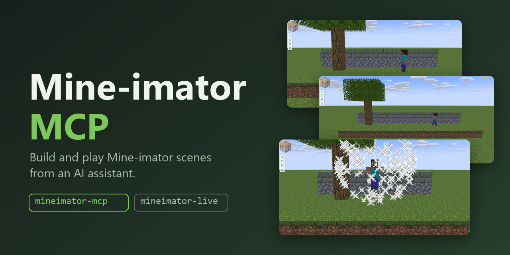
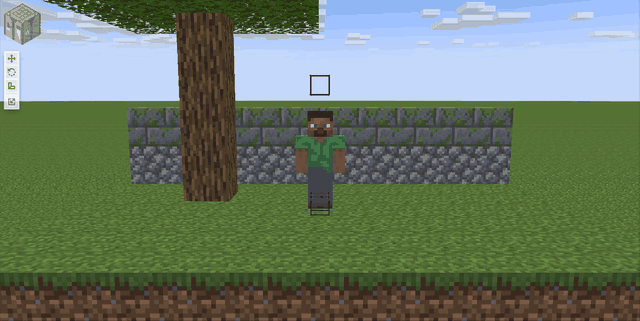
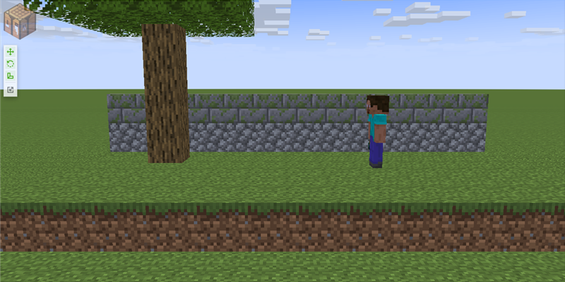
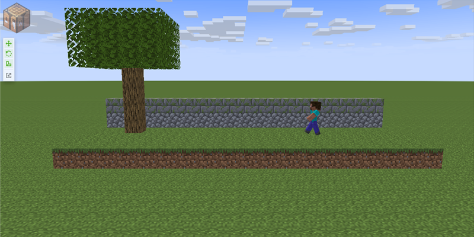
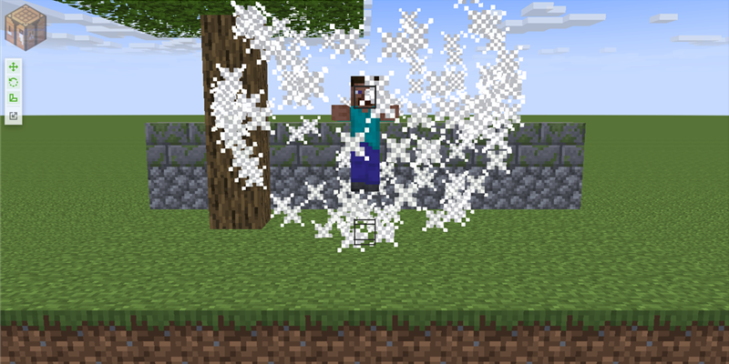

# Mine-imator MCP

Two small [MCP](https://modelcontextprotocol.io) servers that let an AI assistant work with
[Mine-imator](https://www.mine-imator.com), the free Minecraft animation tool.

- `mineimator-mcp` (in `mcp/`) edits `.miproject` files directly. It builds scenes from the app's own library
  (characters, mobs, blocks, items, particles), poses and animates them, sets cameras and camera cuts, and saves a new project.
  Mine-imator does not need to be running.
- `mineimator-live` (in `live/`) drives the running Mine-imator window on Windows: open a project, play, pause, take a screenshot.
  It is how an assistant can look at what it just built.



The animation above was captured with `mineimator-live` while Mine-imator played `mcp/examples/scenes/jump.miproject`.
The scene itself was generated with `mineimator-mcp`.

This is an unofficial community project. It is not affiliated with or endorsed by the author of Mine-imator.

## Quick start

You need Node.js 24 or newer (the servers run TypeScript directly, there is no build step) and, for the library tools,
a copy of Mine-imator 2.0.2 on disk.

```
git clone https://github.com/Zeatrex01/mineimator-mcp.git
cd mineimator-mcp
(cd mcp  && npm install)
(cd live && npm install)
```

Then add the servers to your MCP client. Use absolute paths.

Claude Code, in a `.mcp.json` (or with `claude mcp add`):

```json
{
  "mcpServers": {
    "mineimator": {
      "command": "node",
      "args": ["/path/to/mineimator-mcp/mcp/src/main.ts"],
      "env": {
        "MINEIMATOR_HOME": "/path/to/Mine-imator",
        "MINEIMATOR_OUTPUT_ROOT": "/path/to/output-folder"
      }
    },
    "mineimator-live": {
      "command": "node",
      "args": ["/path/to/mineimator-mcp/live/src/main.ts"],
      "env": { "MINEIMATOR_HOME": "/path/to/Mine-imator" }
    }
  }
}
```

Claude Desktop: put the same `mcpServers` block in `claude_desktop_config.json`. On Windows write the paths with forward
slashes (`C:/path/to/...`) or doubled backslashes.

Any other MCP client: both servers are plain stdio servers started with `node <path>/src/main.ts`.

`mineimator-live` is optional and Windows only. `MINEIMATOR_HOME` is the folder that contains `Mine-imator.exe` and `Data/`.
`MINEIMATOR_OUTPUT_ROOT` limits where `save_project` may write.

A first conversation might go: "Open `mcp/examples/scenes/walk-cycle.miproject` as a new scene, add a chicken next to the
character, cut to a second camera at 2 seconds, and save it as `my-scene.miproject`."

## Tools

### mineimator-mcp

| Tool | What it does |
|---|---|
| `open_project` | Load a `.miproject` into a session, as an editable copy or as the donor for a new scene. |
| `list_library` | List what the installed Mine-imator ships: characters and mobs, blocks, items, particle presets. |
| `list_templates`, `list_timelines` | Inspect what a project contains and what can be copied. |
| `place_character` | Add a library character or mob by name, or copy a rig from the donor. |
| `place_blocks`, `place_prop` | Build structures from real blocks on a grid; place a single block, item or debug shape. |
| `give_item` | Put an item in a character's hand. |
| `place_particles` | Add a spawner from a built-in preset. |
| `place_set`, `set_parent`, `set_skin` | Copy a set, re-parent a timeline, give a character a PNG skin. |
| `set_pose`, `add_keyframe`, `animate_path` | Pose from a named pose library, key any channel, move an object along a path. |
| `set_camera`, `set_shots`, `set_work_camera` | Pose cameras, cut between them in one export, set the editor's viewport camera. |
| `set_output` | Picture size, speed and length of the export. |
| `add_cue`, `export_cues` | Keep sound, text and narrator notes for the video editor. |
| `validate_project`, `save_project` | Check the format, then write a new file. Never overwrites. |
| `render`, `close_project` | `render` hands off the manual export steps; `close_project` drops the session. |

Details, parameters and error codes: [mcp/README.md](mcp/README.md).

### mineimator-live

| Tool | What it does |
|---|---|
| `launch` | Start Mine-imator if it is not running. |
| `focus` | Bring the window to the front. |
| `open_project` | Open a `.miproject` through the app's file dialog. Refuses when there are unsaved changes. |
| `play`, `pause`, `go_to_start` | Control playback and report whether the picture changed. |
| `screenshot` | PNG of the Mine-imator window only, at most 960 px tall. |
| `press`, `click` | Low-level keys and clicks. |

Details: [live/README.md](live/README.md) and [docs/live-shortcuts.md](docs/live-shortcuts.md).

## Examples

Three short scenes in `mcp/examples/scenes/`, built only from Mine-imator's library by `mcp/examples/build-scenes.ts`
(the script is a worked example of the tools).

| Walk cycle (4 s) | Run cycle (3 s) | Jump (3 s) |
|---|---|---|
|  |  |  |

Open any of them in Mine-imator, or regenerate them:

```
cd mcp
MINEIMATOR_HOME=/path/to/Mine-imator node examples/build-scenes.ts --out examples/scenes
```

They are a first pass at animation, not polished work.

## How it works

`mineimator-mcp` reads and writes the `.miproject` JSON that Mine-imator 2.0.2 stores (format 34). Every edit runs on a copy
in memory and is kept only if the project still validates. The library tools read the installed app's data files, read only.
It does not patch, launch or automate Mine-imator.

Mine-imator has no command-line or headless export, so rendering stays a manual step: open the saved project and choose
File > Export movie. The `render` tool says this plainly and lists the steps.

`mineimator-live` is separate. It uses a small PowerShell helper to focus the window, send keys and take window screenshots,
and it never modifies the app.

## Safety

- `save_project` never overwrites an existing file, and no tool edits a file in place.
- `MINEIMATOR_OUTPUT_ROOT` confines everything that is written to one folder.
- A project that fails validation is not saved.
- `mineimator-live` refuses to open a project while the window title shows unsaved changes, refuses `alt+f4`, `f11` and `f12`,
  and stops instead of typing when Windows will not give it the focus.
- No screenshot is taken unless asked, and none is stored by the server.

## Known limitations

- The camera cuts written by `set_shots` follow Mine-imator's source, but I have not exported a movie to confirm them. Export
  once and watch.
- Block `facing` states (stairs and similar) and log `axis` are not calibrated; which compass word points which way is untested.
- The item grip in `give_item` is one fixed offset, a first guess. The walk, run and jump poses were checked on screen; the
  emotion poses were not.
- The animation in the examples is basic.
- `play` and `pause` in `mineimator-live` judge motion by comparing two small grayscale samples, so a still scene looks the same
  playing or paused.
- A question dialog drawn inside Mine-imator is invisible to the live helper. If Mine-imator runs as administrator, Windows may
  drop the input; this has not been tried.
- No audio timelines and no custom models or resource packs yet.

## Compatibility

- Mine-imator 2.0.2, project format 34. Other versions have not been tested.
- Node.js 24 or newer.
- `mineimator-mcp` is plain Node and should run anywhere Node does; it has only been run on Windows.
- `mineimator-live` needs Windows and Windows PowerShell 5.1.

## Tests

```
cd mcp  && npm test && npm run check
cd live && npm test && npm run check
```

Tests that need an installed Mine-imator or a folder of real projects are skipped unless you set `MINEIMATOR_HOME` or
`MINEIMATOR_ARCHIVE`. The live test is opt-in: `MINEIMATOR_LIVE=1 npm run test:live`.

## Contributing

Issues and pull requests are welcome. See [CONTRIBUTING.md](CONTRIBUTING.md) and [CHANGELOG.md](CHANGELOG.md).

## License

MIT, see [LICENSE](LICENSE). Copyright (c) 2026 Zeatrex01.

Mine-imator is a separate project with its own license and author. This repository contains no Mine-imator code or assets; the screenshots show the application.
